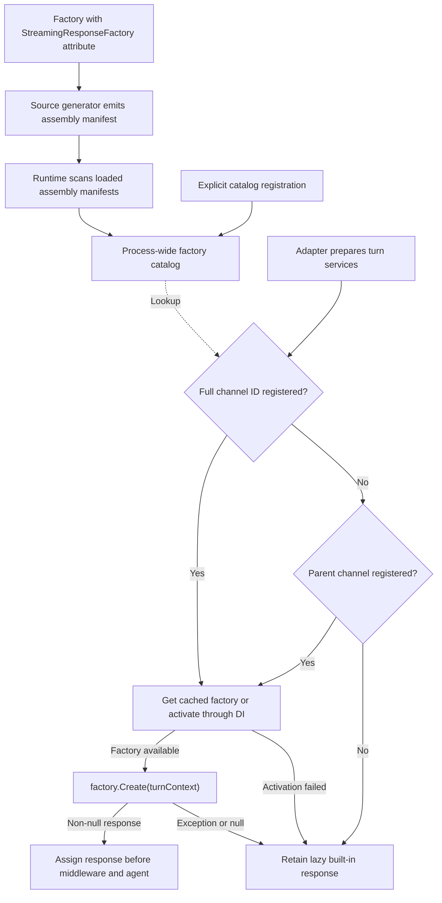
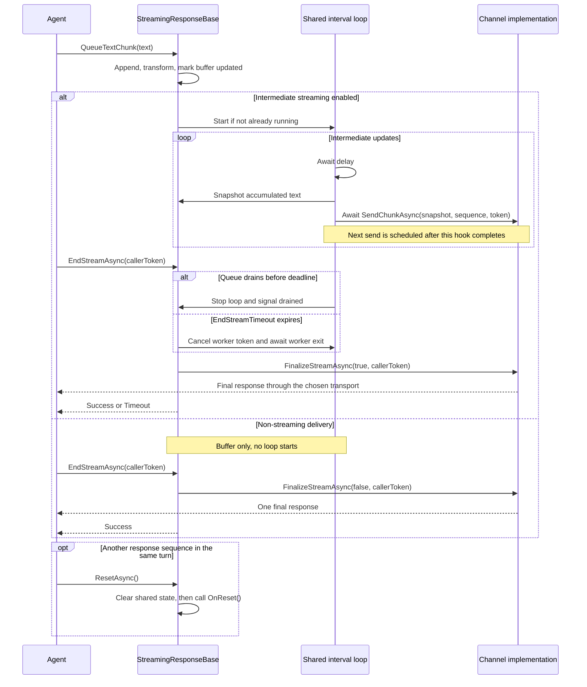

# Extend IStreamingResponse with IStreamingResponseFactory

Use `IStreamingResponseFactory` to select a channel-specific streaming response without changing
agent handlers. Handlers continue to call `ITurnContext.StreamingResponse`; your extension decides
how buffered text, informative updates, and final messages reach the channel.

This guide is for .NET AgentExtension authors. It covers the contracts in
`Microsoft.Agents.Builder`, automatic discovery, dependency injection, and the lifecycle rules
needed to implement a response safely. Keep channel-specific behavior in the owning extension
project, not in shared Builder or Hosting code.

## Choose the extension point

| Contract | Responsibility |
|---|---|
| `IStreamingResponse` | The agent-facing API: queue text, add response metadata, end a stream, and reset it. |
| `StreamingResponseBase` | Public base class implementing buffering, sequencing, the interval loop, and end/reset coordination. Derive from it for most custom transports. |
| `IStreamingResponseFactory` | Creates a response bound to the current `ITurnContext`. |
| `StreamingResponseFactoryAttribute` | Associates a factory type with one channel or full channel/subchannel ID. |
| `StreamingResponseFactoryCatalog` | Process-wide channel-to-factory-type mapping used by the adapter. |

The built-in `StreamingResponse`, `TeamsStreamingResponse`, and `M365CopilotStreamingResponse`
classes are **internal**. They are not base classes for an external extension. Derive from the
public `StreamingResponseBase`, or implement `IStreamingResponse` directly when you need to own
the entire lifecycle. A direct implementation must supply every interface member and its own
buffering, synchronization, completion, and reset behavior.

A factory selects a response; it does not add a channel adapter, configure credentials, or change
the host's HTTP transport. For example, `DeliveryModes.Stream` selects Activity Protocol SSE
delivery in the host. A native channel can stream through its own API without using that delivery
mode.

## Understand factory selection

`ChannelServiceAdapterBase` applies the factory after populating turn services and before running
the middleware/agent pipeline. Its lookup uses the incoming activity's channel ID:

1. Look for the full ID, such as `contoso:preview`.
2. If no full-ID registration exists, look for the parent ID, such as `contoso`.
3. Activate the selected factory through the adapter's service provider, or reuse its cached instance.
4. Call `Create(turnContext)` and assign the returned response to the turn.

Catalog keys are case-insensitive. Parent-channel lookup happens only when the full-ID registration
is absent: a broken full-ID factory does not cause the parent factory to be tried.



Without a factory, `TurnContext` lazily selects M365 Copilot, Teams, or the shared Activity Protocol
response. Factory activation and `Create` failures are logged and leave that built-in behavior in
place. For an unknown channel, the shared response normally buffers one final message, unless the
incoming delivery mode enables streaming.

This integration requires a `ChannelServiceAdapterBase`-derived adapter constructed with an
`IServiceProvider`, as in the normal `CloudAdapter` integration. Its older constructors without a
service provider do not activate factories. An adapter derived directly from `ChannelAdapter`
does not acquire factory integration merely by using the catalog. Likewise,
`new TurnContext(...)` alone does not resolve a factory.

### Factory and response lifetimes

The adapter caches **one factory instance per factory type**, not one per turn or channel ID.
If several IDs map to the same type, they share that adapter's factory instance. `Create` runs
for each matching turn and should return a **new response** each time.

Keep factories safe for concurrent calls. Store only reusable dependencies and configuration in
factory fields; put the current context, conversation identifiers, credentials obtained for the
turn, stream handles, and buffered text on the per-turn response. Do not capture request-scoped
services in an adapter-lifetime factory.

The adapter uses `ActivatorUtilities.CreateInstance`, which injects constructor dependencies but
does not resolve a pre-registered factory instance. Adding
`services.AddSingleton<IStreamingResponseFactory, MyFactory>()` alone does not select a channel
or replace the instance the adapter creates.

## Implement a response

The following example supports a hypothetical `contoso` channel whose existing adapter can send
and edit message activities. It sends the first text snapshot as a message, then updates that
message with each newer snapshot. This is an edit-based transport, not Teams streaming or a
native append-stream API.

The channel adapter must return a stable `ResourceResponse.Id` from the first send and support
`UpdateActivityAsync`. The example deliberately buffers one final response for `ExpectReplies`
and `Stream` requests instead of trying to edit messages through a hosted JSON/SSE response.

Create `ContosoStreamingResponse.cs` in your extension project:

```csharp
using System;
using System.Collections.Generic;
using System.Threading;
using System.Threading.Tasks;
using Microsoft.Agents.Builder;
using Microsoft.Agents.Core.Models;
using Microsoft.Extensions.Logging;

namespace Contoso.Agents;

public sealed class ContosoStreamingResponse : StreamingResponseBase
{
    private readonly ITurnContext _context;
    private readonly ILogger<ContosoStreamingResponse> _logger;

    public ContosoStreamingResponse(
        ITurnContext context,
        ILogger<ContosoStreamingResponse> logger)
    {
        _context = context ?? throw new ArgumentNullException(nameof(context));
        _logger = logger ?? throw new ArgumentNullException(nameof(logger));
        SetDefaults();
    }

    protected override Task SendChunkAsync(
        string bufferedText,
        int sequenceNumber,
        CancellationToken cancellationToken)
    {
        return SendOrUpdateAsync(
            new Activity
            {
                Type = ActivityTypes.Message,
                Text = bufferedText
            },
            cancellationToken);
    }

    protected override Task SendInformativeAsync(
        string text,
        int sequenceNumber,
        CancellationToken cancellationToken)
    {
        return Task.CompletedTask;
    }

    protected override async Task FinalizeStreamAsync(
        bool streamedPath,
        CancellationToken cancellationToken)
    {
        var activity = FinalMessage ?? new Activity { Text = Message };
        activity.Type = ActivityTypes.Message;

        if (Attachments != null && Attachments.Count > 0
            && !ReferenceEquals(activity.Attachments, Attachments))
        {
            activity.Attachments ??= new List<Attachment>();
            foreach (var attachment in Attachments)
            {
                activity.Attachments.Add(attachment);
            }
        }

        if (string.IsNullOrWhiteSpace(activity.Text)
            && (activity.Attachments == null || activity.Attachments.Count == 0))
        {
            return;
        }

        if (IsStreamingChannel)
        {
            await SendOrUpdateAsync(activity, cancellationToken).ConfigureAwait(false);
        }
        else
        {
            await _context.SendActivityAsync(activity, cancellationToken).ConfigureAwait(false);
        }
    }

    protected override Task<StreamErrorAction> HandleSendErrorAsync(
        Exception exception,
        CancellationToken cancellationToken)
    {
        _logger.LogWarning(exception, "Contoso streaming send failed.");
        return Task.FromResult(StreamErrorAction.Cancel);
    }

    protected override void OnReset()
    {
        SetDefaults();
    }

    private void SetDefaults()
    {
        var deliveryMode = _context.Activity.DeliveryMode;
        IsStreamingChannel =
            !string.Equals(deliveryMode, DeliveryModes.ExpectReplies, StringComparison.OrdinalIgnoreCase)
            && !string.Equals(deliveryMode, DeliveryModes.Stream, StringComparison.OrdinalIgnoreCase);
        Interval = 750;
    }

    private async Task SendOrUpdateAsync(
        IActivity activity,
        CancellationToken cancellationToken)
    {
        if (string.IsNullOrEmpty(StreamId))
        {
            var response = await _context.SendActivityAsync(
                activity, cancellationToken).ConfigureAwait(false);
            if (string.IsNullOrEmpty(response.Id))
            {
                throw new InvalidOperationException(
                    "Contoso streaming requires an activity ID from the first send.");
            }

            StreamId = response.Id;
        }
        else
        {
            activity.Id = StreamId;
            await _context.UpdateActivityAsync(
                activity, cancellationToken).ConfigureAwait(false);
        }
    }
}
```

The base class accumulates text and schedules calls to `SendChunkAsync`; do not add another
timer or background loop. Informative updates are intentionally a no-op in this example because
the hypothetical channel has no status-update UI.

This example supports text, `FinalMessage`, and attachments. It does not translate citation,
AI-label, sensitivity-label, feedback, or timeout-notification settings into a channel-specific
representation. Add those mappings if the channel supports them. `StreamingResponseBase` stores
these settings; it does not automatically add them to outgoing activities. Metadata already
placed on `FinalMessage` is passed to the adapter with that activity.

## Create the factory

Create `ContosoStreamingResponseFactory.cs` in the same project:

```csharp
using Microsoft.Agents.Builder;
using Microsoft.Extensions.Logging;

namespace Contoso.Agents;

[StreamingResponseFactory("contoso")]
public sealed class ContosoStreamingResponseFactory : IStreamingResponseFactory
{
    private readonly ILogger<ContosoStreamingResponse> _logger;

    public ContosoStreamingResponseFactory(ILogger<ContosoStreamingResponse> logger)
    {
        _logger = logger;
    }

    public IStreamingResponse Create(ITurnContext turnContext)
    {
        return new ContosoStreamingResponse(turnContext, _logger);
    }
}
```

Use a concrete factory with a public constructor. The factory type itself can be internal when
it is discovered through its assembly manifest, as in the Slack extension. Public visibility is
convenient when a host explicitly registers the type.

`Create` is synchronous: construct and configure the response here, and defer network I/O until
the response's asynchronous send hooks run. Do not start streaming or cache a turn context in
the factory.

To specialize only a subchannel, use its full ID on a different factory, for example
`[StreamingResponseFactory("contoso:preview")]`. Registering `"contoso"` covers subchannels
without a more specific registration.

## Make the factory discoverable

### Automatic discovery

The SDK's `StreamingResponseFactorySourceGenerator` emits a
`StreamingResponseFactoryAssemblyAttribute` for each attributed factory. The runtime reads those
assembly manifests and then reads the class attribute to obtain each channel ID.

Ensure that the SDK analyzers run when building the extension. NuGet consumers receive the
analyzers through the `Microsoft.Agents.Core` package. A repository project reference does not
automatically propagate them: the
[Slack extension project](../src/libraries/Extensions/Microsoft.Agents.Extensions.Slack/Microsoft.Agents.Extensions.Slack.csproj)
shows the explicit analyzer project reference with `OutputItemType="Analyzer"` and
`ReferenceOutputAssembly="false"`.

The runtime scans **loaded assemblies** and subscribes to `AppDomain.AssemblyLoad` for later
loads. A package/project reference alone is not proof that its assembly has loaded. Load the
extension during host startup, before processing its channel's turns. An extension already
loaded through its normal registration or runtime type use needs no additional factory-specific
service-collection call.

For general extension loading and service registration, see
[Writing an AgentExtension](writing-an-agent-extension.md#how-automatic-discovery-works).
A factory-only package still needs an explicit load or registration path; its factory attribute
is not itself a guarantee that the assembly will be preloaded.

### Explicit registration

A host can register a factory type directly during startup, before accepting requests:

```csharp
using Contoso.Agents;
using Microsoft.Agents.Builder;

StreamingResponseFactoryCatalog.Register(
    "contoso",
    typeof(ContosoStreamingResponseFactory));
```

This provides the mapping without relying on a generated manifest, and the type reference loads
the extension assembly. It still uses DI to activate the factory; it does not register its
constructor dependencies.

If you cannot run the generator but still want manifest discovery, place the following
assembly-level attribute after the `using` directives and before namespace/type declarations.
Keep the `[StreamingResponseFactory("contoso")]` attribute on the factory class:

```csharp
[assembly: Microsoft.Agents.Builder.StreamingResponseFactoryAssemblyAttribute(
    typeof(Contoso.Agents.ContosoStreamingResponseFactory))]
```

Use one manifest-generation approach; do not hand-author a manifest that the generator already
emits. Avoid competing factories for the same key: `Register` replaces the catalog entry, and
assembly load/scan order is not a suitable override policy.

### Constructor dependencies

Normal ASP.NET Core hosting supplies logging for the example factory. For a native transport,
inject reusable services such as `IHttpClientFactory`, configuration, or a channel client.
Those dependencies must already be registered in the adapter's service provider.

An AgentExtension can register its internal dependencies through
[IAgentServiceRegistrar](writing-an-agent-extension.md#custom-di-with-iagentserviceregistrar).
There is no need to register an `IStreamingResponse` singleton: the factory creates responses
for individual turns.

## Keep agent handlers transport-independent

Once selected, the custom response is exposed by the same read-only
`ITurnContext.StreamingResponse` property as a built-in response. Agent code does not resolve
the factory or assign the property.

For example, this handler works with the custom implementation and the built-in responses:

```csharp
using System.Threading;
using System.Threading.Tasks;
using Microsoft.Agents.Builder;
using Microsoft.Agents.Builder.App;
using Microsoft.Agents.Builder.State;
using Microsoft.Agents.Core.Models;

public sealed class ContosoAgent : AgentApplication
{
    public ContosoAgent(AgentApplicationOptions options) : base(options)
    {
        OnActivity(ActivityTypes.Message, OnMessageAsync, rank: RouteRank.Last);
    }

    private static async Task OnMessageAsync(
        ITurnContext turnContext,
        ITurnState turnState,
        CancellationToken cancellationToken)
    {
        var response = turnContext.StreamingResponse;
        try
        {
            await response.QueueInformativeUpdateAsync("Working...", cancellationToken);
            response.QueueTextChunk("Hello ");
            response.QueueTextChunk("from Contoso.");
        }
        finally
        {
            await response.EndStreamAsync(cancellationToken);
        }
    }
}
```

Replace the two text chunks with your model's output as needed. Chunk calls can be coalesced into
one intermediate snapshot; they do not imply one channel request per chunk.

Explicitly end the response even when the channel is buffering rather than streaming.
`AgentApplication` has a finally-path safeguard for responses whose `IsStreamStarted()` is
true, but a non-streaming response never starts that loop. A response that has already fallen
back to non-streaming also needs explicit finalization.

The caller's cancellation token is passed to finalization. If it is already canceled, the final
send may be canceled too; ending a stream does not guarantee delivery after the turn has been
canceled.

## Implement the transport hooks correctly

### Required hooks

| Hook | Required behavior |
|---|---|
| `SendChunkAsync(string, int, CancellationToken)` | Send a **full accumulated text snapshot**, not an assumed delta. The sequence number is 1-based. Propagate cancellation to channel I/O. |
| `SendInformativeAsync(string, int, CancellationToken)` | Send a status update, or return a completed task when unsupported. The first call is awaited directly on the caller's path; later updates use the loop. |
| `FinalizeStreamAsync(bool, CancellationToken)` | Deliver the final buffered response and/or close native stream resources. Handle both streaming and non-streaming delivery. Include content not sent before a drain timeout. |
| `HandleSendErrorAsync(Exception, CancellationToken)` | Map send failures to an error action and perform any required native-resource cleanup. Do not assume finalization will follow cancellation. |

`streamedPath` tells you which branch `EndStreamAsync` entered. It is not the current capability
flag: a fallback during draining can leave `streamedPath == true` and
`IsStreamingChannel == false`. Check the current flag when choosing the final delivery format.

For a native **append-only** API, convert the full snapshot to an unsent suffix. Keep a cursor,
advance it only after a successful append, and clear it in `OnReset`. This assumes already-sent
text remains a stable prefix; a transformation that rewrites that prefix needs a different
reconciliation strategy. The
[Slack implementation](../src/libraries/Extensions/Microsoft.Agents.Extensions.Slack/Api/SlackStreamingResponse.cs)
demonstrates lazy native stream creation, delta appends, and sending any remaining suffix while
closing the stream.

Prefer `ITurnContext.SendActivityAsync`/`UpdateActivityAsync` when the adapter supports the
operation. Direct native API calls bypass the turn context's send/update callbacks and host
response routing; an extension using them must account for those differences.

### Optional hooks and controls

| Hook or member | Use |
|---|---|
| `TransformBufferedText` | Normalize accumulated text after each chunk. Runs under the buffer lock; keep it synchronous and inexpensive. |
| `OnBeforeSendIntervalAsync` | Perform channel lifecycle checks or keep-alives before a loop pass. Return `false` to stop the loop; use `FallbackToNonStreaming()` as well when final delivery must switch formats. |
| `OnSendCompleted` | Track successful informative/text sends, for example to update an inactivity clock. |
| `OnReset` | Clear native state and restore implementation-specific defaults. Runs under the reset lock; do not perform asynchronous I/O here. |
| `IsStreamingChannel` | Protected setter controlling intermediate delivery. Decide from channel capabilities and the incoming delivery mode. |
| `StreamId` | Protected setter for the channel's stream identity. The base does not allocate one. |
| `FallbackToNonStreaming()` | Disable intermediate streaming, stop the loop, and allow later final delivery. It does not stop model generation. |
| `GetNextSequenceNumber()` | Allocate a sequence number for extra channel-specific updates. |
| `SendStreamTimedOutNotification` | Override when the channel can close its streaming UI and continue later through non-streaming delivery. The base returns `false`. |

For comparison, Teams obtains its stream ID from the first successful send. WebChat/DirectLine
pre-generate a GUID. Native channels may have a separate remote handle as well as a local
`StreamId`. Do not assume one identity strategy works for every transport.

## Preserve lifecycle and error behavior



This diagram shows successful sends and the drain-timeout path. Error actions can stop the loop
earlier:

| `StreamErrorAction` | Effect |
|---|---|
| `Continue` | Drop the failed send and continue. This is **not a retry**. |
| `FallbackToNonStreaming` | Stop intermediate sends and set `IsStreamingChannel` to `false`. Continue buffering so a later `EndStreamAsync` can finalize normally. |
| `Cancel` | Stop the stream and skip finalization. `EndStreamAsync` reports `Error`, or `UserCancelled` if the hook set `UserCancelledStream = true`. |

Clean up remote resources in the error hook before returning `Cancel`; for example, Slack
attempts to close its native stream after an append failure. Propagate the hook's cancellation
token through cleanup as well as normal sends. Avoid logging message content or credentials.

`HandleSendErrorAsync` covers the intermediate-send path and the before-interval hook, not
exceptions thrown by your `FinalizeStreamAsync`. Define appropriate final-send logging and
exception handling in your implementation.

### Completion and cancellation

- `EndStreamTimeout` defaults to two minutes and bounds the queue-drain wait, not model generation.
  After it expires, the base cancels the worker token and waits for in-flight work to stop before
  finalizing. A hook that ignores cancellation can extend that wait.
- Finalization receives the **caller's token**, not the canceled worker token, so a drain timeout
  does not itself cancel the final send.
- `Timeout` can therefore mean that finalization ran after a drain timeout; it does not necessarily
  mean the final response was lost.
- `NotStarted` means an enabled streaming response never started its loop. In that case the base
  does not call the finalizer. Merely setting `FinalMessage` or adding attachments does not start
  a stream; queue text/an informative update first, or send a standalone activity directly.
- A second `EndStreamAsync` returns `AlreadyEnded`. Call `ResetAsync` before starting another
  sequence on that response.

Use one coordinated producer/finalizer per response: await the first informative update and
finish queuing content before ending or resetting. The loop serializes its sends, but that is
not a promise that arbitrary concurrent lifecycle calls are safe.

### Reset behavior

`ResetAsync` ends an active stream, clears queued/buffered content, resets sequencing and
`StreamId`, and clears final-message, citation, attachment, label, and feedback state. It restores
shared defaults such as `InitialDelay` and `EndStreamTimeout`, then calls `OnReset`.

Your override must reset native handles, append cursors, channel timers, `IsStreamingChannel`,
and channel-specific intervals/defaults. In the example, `OnReset` restores the 750 ms interval
and re-evaluates delivery mode; the base has already cleared the message ID.

The factory is **not called again** by `ResetAsync`. If it applies configured defaults that
should survive a reset, retain those defaults on the response and reapply them in `OnReset`,
as the Slack factory/response pair does. Do not reuse the response across turns: it remains bound
to its original context.

## Validate and troubleshoot

Test the response independently, then exercise factory discovery through the real adapter.
Constructing a `TurnContext` in a unit test is sufficient for direct response tests, but does
not test automatic factory selection.

| Test | Verify |
|---|---|
| Discovery and dependencies | The assembly is loaded, the manifest or explicit mapping exists, and constructor dependencies resolve. The pipeline sees your response type. |
| Channel matching | A full-ID registration wins over the parent; the parent handles an unregistered subchannel; unrelated channels retain their built-ins. |
| Lifetime isolation | Concurrent turns receive distinct responses even though the factory is reused. |
| Buffering and ordering | Rapid chunks may coalesce; snapshots contain all accumulated text; no loop sends overlap. Native append transports send each suffix once. |
| Finalization | The final message contains all buffered text, including an unsent tail, and native resources are closed. |
| Non-streaming delivery | Informative updates cause no intermediate sends, text buffers without a worker, and explicit completion sends the final response. |
| Failure policy | Cancellation, fallback, and continue actions have the intended finalization and result behavior. |
| Drain timeout | In-flight operations observe cancellation before finalization; the finalizer receives the caller's token. |
| Reset | A second sequence has fresh identity/cursors, restored defaults, and no content or metadata from the first. |
| Metadata | Supported attachments, citations, labels, feedback, and `FinalMessage` are translated correctly; unsupported settings have documented behavior. |

Use synchronization primitives such as `TaskCompletionSource` to coordinate fake sends instead
of `Task.Delay` assertions. For adapter/catalog tests, use unique channel IDs or restore prior
registrations so the process-wide catalog does not leak test state.

If the built-in response appears unexpectedly, check these conditions first:

1. **Mapping:** Does `StreamingResponseFactoryCatalog.TryGetFactoryType` find the expected full
   or parent channel key?
2. **Loading:** Has the extension assembly loaded, and was the assembly manifest generated?
3. **Activation:** Are the factory constructor and dependencies usable? Inspect adapter warnings.
4. **Adapter integration:** Does the turn run through a `ChannelServiceAdapterBase` instance
   with a service provider?

Factory activation failures are cached per type for that adapter's lifetime. Correct the
registration/configuration and recreate the adapter, normally by restarting the host.
`Create` failures occur per turn rather than poisoning that activation cache. An absent mapping
is not cached as an activation failure, so an extension loaded later can serve subsequent turns.

## Related guides and source

- [Writing an AgentExtension](writing-an-agent-extension.md)
- [Streaming response sequence diagrams](streaming-response-sequence-diagram.md)
- [CloudAdapter pipeline sequence diagram](full-cloudadapter-sequence-diagram.md)
- [IStreamingResponse](../src/libraries/Builder/Microsoft.Agents.Builder/IStreamingResponse.cs)
- [StreamingResponseBase and StreamErrorAction](../src/libraries/Builder/Microsoft.Agents.Builder/StreamingResponseBase.cs)
- [IStreamingResponseFactory](../src/libraries/Builder/Microsoft.Agents.Builder/IStreamingResponseFactory.cs)
- [Factory catalog](../src/libraries/Builder/Microsoft.Agents.Builder/StreamingResponseFactoryCatalog.cs)
- [Factory assembly discovery](../src/libraries/Builder/Microsoft.Agents.Builder/StreamingResponseFactoryAssemblyAttribute.cs)
- [Factory source generator](../src/libraries/Core/Microsoft.Agents.Core.Analyzers/StreamingResponseFactorySourceGenerator.cs)
- [Adapter factory integration](../src/libraries/Builder/Microsoft.Agents.Builder/ChannelServiceAdapterBase.cs)
- [Slack factory](../src/libraries/Extensions/Microsoft.Agents.Extensions.Slack/Api/SlackStreamingResponseFactory.cs)
- [Slack native response](../src/libraries/Extensions/Microsoft.Agents.Extensions.Slack/Api/SlackStreamingResponse.cs)
- [Shared streaming response tests](../src/tests/Microsoft.Agents.Builder.Tests/StreamingResponseTests.cs)
