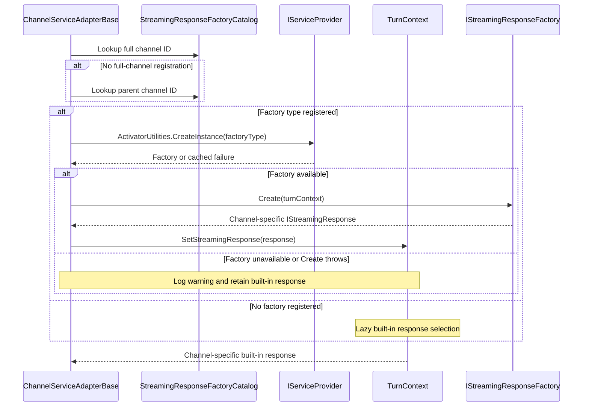
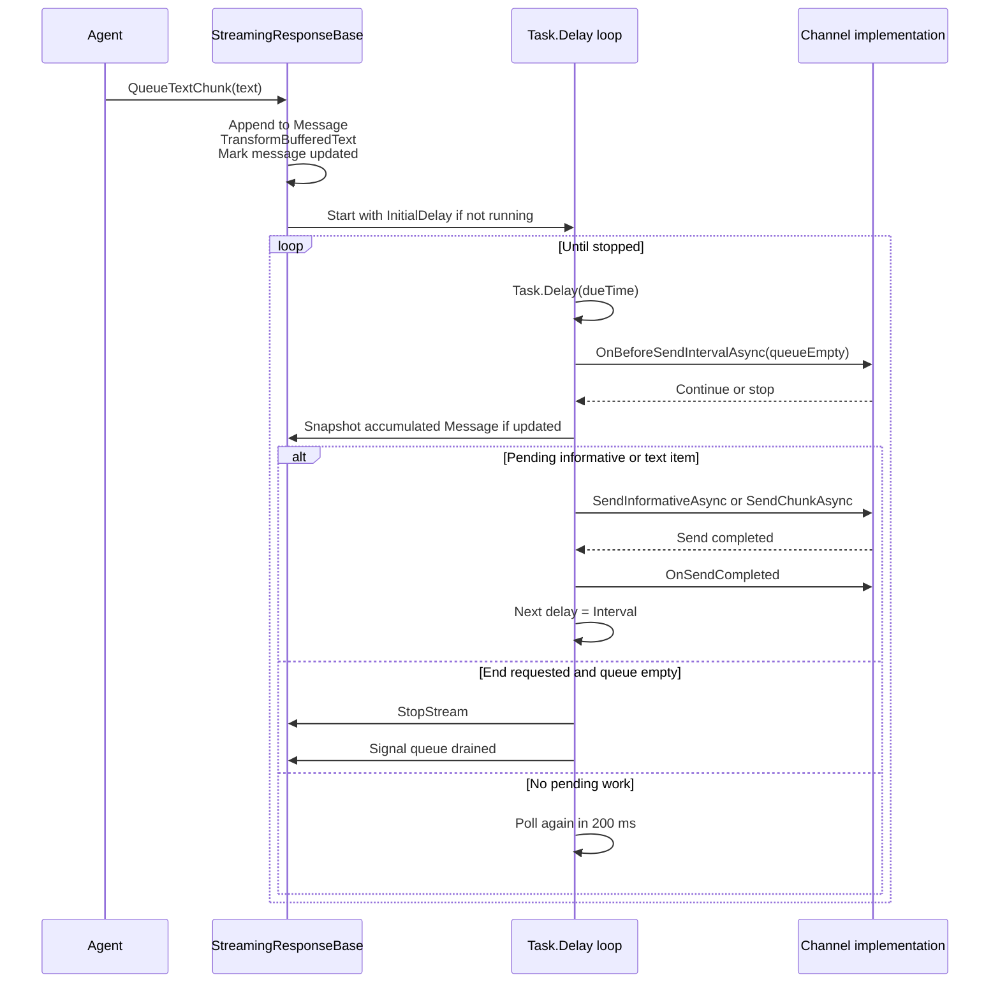
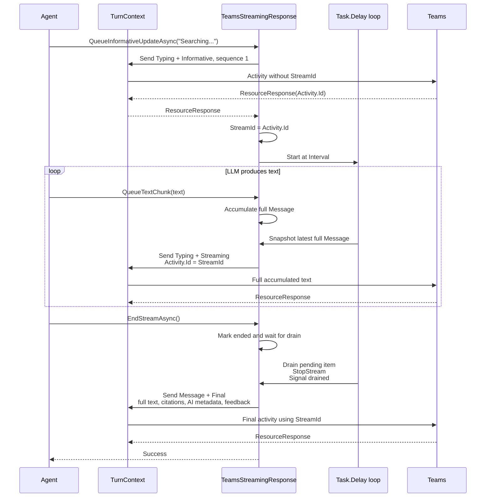
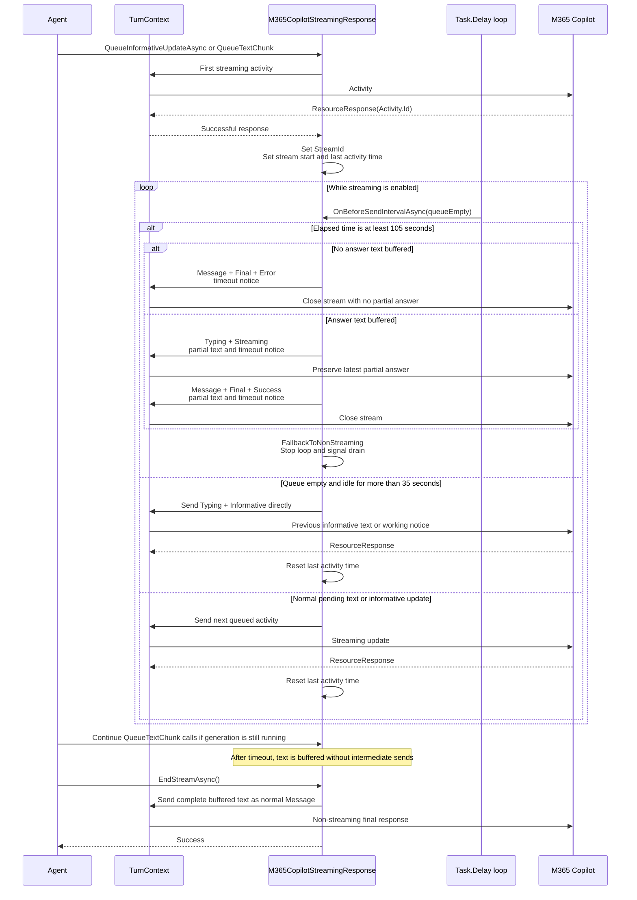
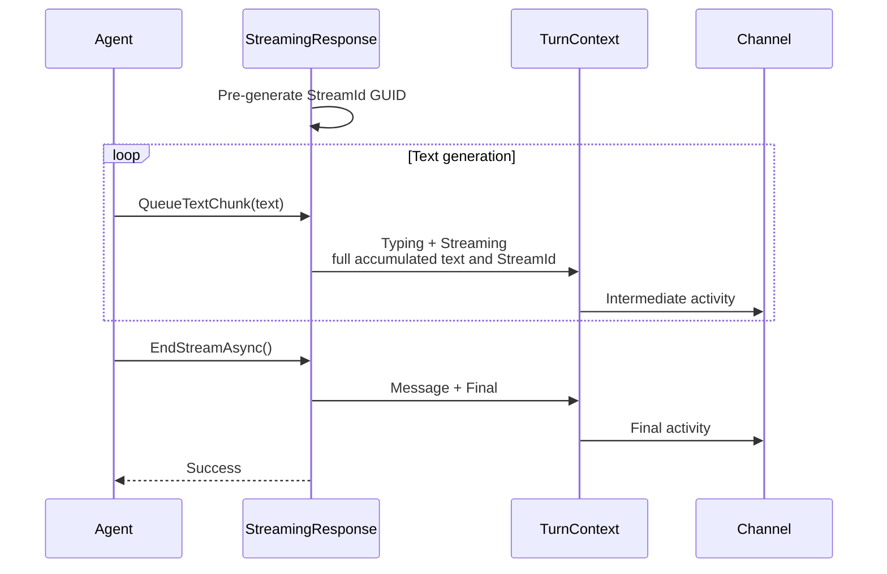
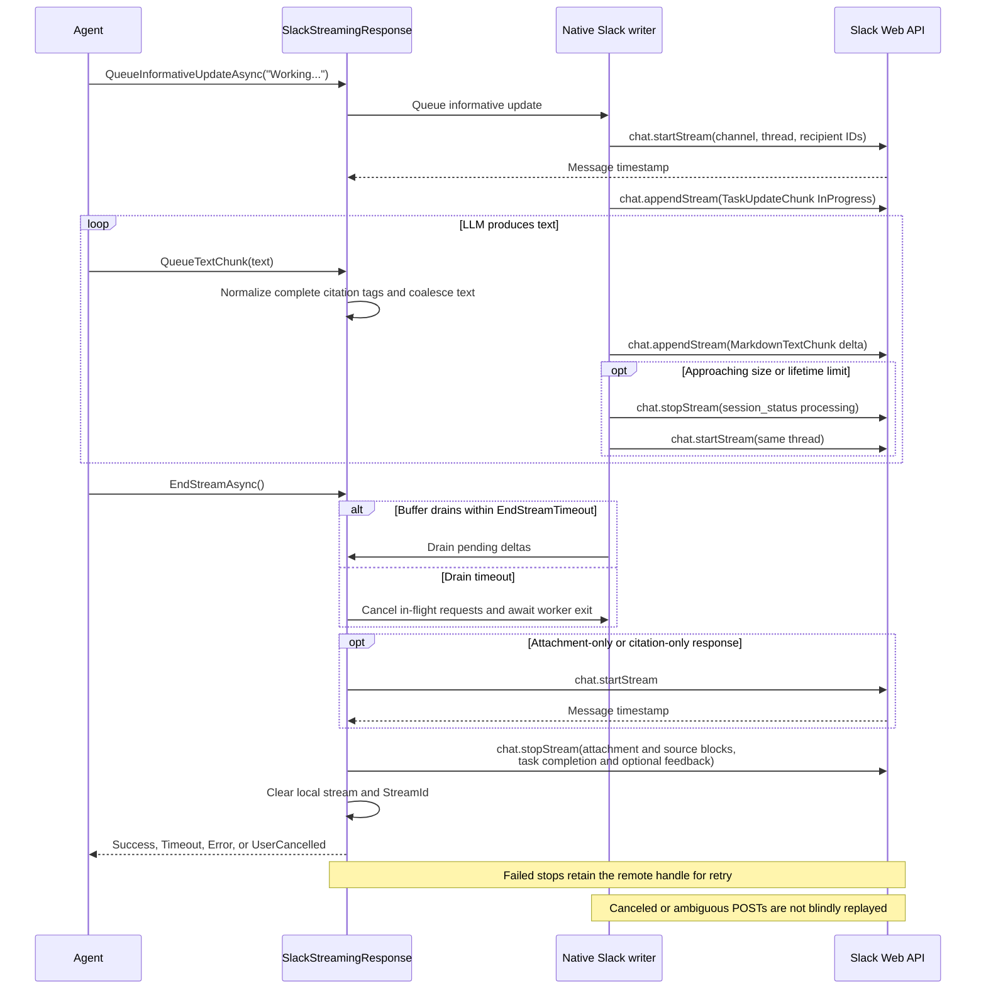
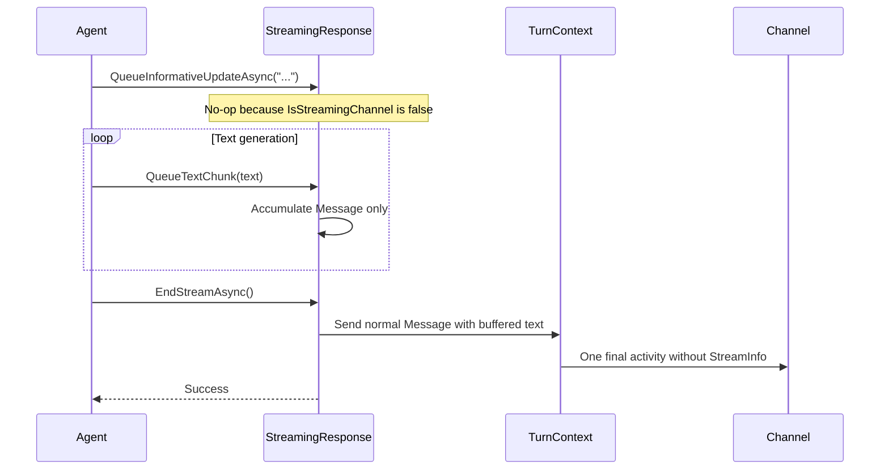

# Streaming Response Sequence Diagrams

`ITurnContext.StreamingResponse` provides one API for Activity Protocol streaming and channel-native
streaming implementations. `StreamingResponseBase` owns buffering, sequencing, the asynchronous interval
loop, end/reset behavior, and error actions. `StreamingResponse` provides the shared Activity Protocol
format, while channel specializations provide defaults, metadata, and error handling.

For implementation guidance and a complete factory/response example, see
[Extend IStreamingResponse with IStreamingResponseFactory](extending-streaming-response.md).

## Response Selection

`ChannelServiceAdapterBase` checks the full channel ID first (for example, `msteams:COPILOT`) and then the
parent channel ID. A discovered factory is instantiated through dependency injection and cached by factory
type. If discovery or creation fails, `TurnContext` uses its built-in response:

- `M365CopilotStreamingResponse` for `msteams:COPILOT`.
- `TeamsStreamingResponse` for Teams and other Teams subchannels.
- `StreamingResponse` for all other channels.

Automatic discovery scans loaded assemblies and subscribes to `AssemblyLoad`; a package or project
reference alone does not load an extension. Load the extension during host startup before processing
its channel's turns, for example by using an extension type. Hosts using a factory-only plugin can
explicitly call `StreamingResponseFactoryCatalog.Register("custom", typeof(CustomStreamingResponseFactory))`.
An extension that is already loaded needs no separate service-collection registration call.

## Channel Defaults

| Channel | Implementation | Interval | Stream identity | Special behavior |
|---|---|---:|---|---|
| Teams | `TeamsStreamingResponse` | 1000 ms | First response `Activity.Id` | Teams-specific errors and feedback metadata |
| M365 Copilot (`msteams:COPILOT`) | `M365CopilotStreamingResponse` | 1000 ms | First response `Activity.Id` | Teams behavior plus 35-second idle notice and 105-second streaming cutoff |
| WebChat / DirectLine | `StreamingResponse` | 500 ms | Pre-generated GUID | Full accumulated text per update |
| `DeliveryModes.Stream` (other channels) | `StreamingResponse` | 100 ms | Pre-generated GUID | Activity Protocol streaming over the host transport |
| Slack | `SlackStreamingResponse` | Native rate-aware pacing | Slack message timestamp | Native chunks, rollover, attachment blocks, and readable sources |
| Other / `ExpectReplies` | `StreamingResponse` | N/A | N/A | Buffers and sends one normal final message |

`InitialDelay` defaults to 250 ms for Activity Protocol responses. Slack implements
`IStreamingResponse` directly and does not use the interval/initial-delay settings.
`FinalMessage` is obsolete; Activity Protocol responses retain legacy compatibility, while native
transports use `AddAttachment` and `AddCitation`.

## Shared `StreamingResponseBase` Loop

The previous `System.Threading.Timer` callback is replaced by a single asynchronous `Task.Delay` loop.
Only one send can be active at a time. Informative updates and buffered text snapshots share one FIFO queue.

`StopStream` runs before the drain signal is set, so `EndStreamAsync` cannot return while
`IsStreamStarted()` still reports `true`.

If draining exceeds `EndStreamTimeout`, the base cancels the worker's token and waits for in-flight
channel work to stop before finalization. Send hooks and error cleanup must propagate this token to
their asynchronous channel operations. Finalization uses the caller's token, not the canceled worker
token, so it can still deliver the buffered final response.

## Teams Flow

Teams assigns the stream ID. The first successful send returns an `Activity.Id`; every later streaming
activity uses that value as both `Activity.Id` and `StreamInfo.StreamId`.

## M365 Copilot Flow

`M365CopilotStreamingResponse` derives from `TeamsStreamingResponse`, retaining Teams stream identity,
error handling, and final-message metadata while adding separate lifecycle requirements:

- The 105-second cutoff begins after the first successful send.
- Successful informative and text sends reset the 35-second inactivity clock.
- An idle keep-alive is sent directly by the current loop iteration. It reuses the most recent informative
  text, or `StreamingTakingTooLongMessage` if none exists.
- At the cutoff, the streaming transport is closed and the response falls back to normal delivery. Content
  generation can continue, and `EndStreamAsync` later sends the complete buffered response as a normal message.

If the agent finishes before the cutoff, `EndStreamAsync` follows the normal Teams finalization path and
sends a `StreamTypes.Final` activity.

## WebChat, DirectLine, and `DeliveryModes.Stream`

These channels use the same accumulated-text behavior as Teams, but the response creates a GUID before the
first send instead of adopting the first `ResourceResponse.Id`.

## Slack Native Streaming

Once loaded, the Slack extension registers `SlackStreamingResponseFactory` for the Slack channel. The
factory is discovered automatically and creates `SlackStreamingResponse` with its `SlackApi` dependency.

Unlike Activity Protocol channels, Slack owns its writer and appends only new text. It shares
rate-limit pacing by app/workspace/method and honors `Retry-After` on explicit throttling.
It rolls over messages before 12,000 accumulated markdown characters or a nine-minute safety
window, preserving the thread and keeping intermediate session closures `processing`.

## Non-Streaming Flow

For unsupported channels and `DeliveryMode.ExpectReplies`, informative updates are ignored, text is buffered,
and no interval loop starts.

If no text, attachments, legacy `FinalMessage`, or prior updates exist, `EndStreamAsync` sends nothing.

## Error Actions

`StreamingResponseBase` asks the implementation to map a send exception to one of three actions:

| Action | Base behavior |
|---|---|
| `Continue` | Drop the failed send and continue the interval loop |
| `FallbackToNonStreaming` | Disable intermediate streaming, stop the loop, and allow a normal final message |
| `Cancel` | Stop the loop; `EndStreamAsync` returns `Error` or `UserCancelled` |

`TeamsStreamingResponse` applies these Teams service policies:

- `ContentStreamNotAllowed` caused by user cancellation returns `UserCancelled`.
- `ContentStreamNotAllowed` with the exceeded-time message updates the existing activity and falls back to
  non-streaming delivery.
- `BadArgument` with `streaming api is not enabled` falls back to non-streaming delivery.
- Other failures cancel the stream.

`StreamingResponse`, used by WebChat, DirectLine, and `DeliveryModes.Stream`, treats send failures as
transport failures and cancels the stream.

Slack does not use these base-class actions. It classifies native errors, retries explicit throttling,
reports `stopped_by_user` as `UserCancelled`, and closes known remote resources on completion/error.
An ambiguous canceled POST is not replayed; a failed stop retains its handle for a later completion attempt.

## Key Implementation Details

- The interval loop uses `Task.Delay`, not `System.Threading.Timer`.
- Only one send runs at a time; the next delay begins after the current send completes.
- Informative updates and text snapshots are sent in FIFO order.
- Activity Protocol intermediate messages contain the full accumulated text; Slack sends only the new delta.
- `EndStreamTimeout` defaults to two minutes.
- `ResetAsync` ends an active stream, clears buffered and synchronization state, restores shared defaults,
  and invokes the implementation-specific reset hook to restore channel defaults and stream identity.
- Factory lookup checks the full channel ID before the parent ID, enabling subchannel specializations.
- Factory instantiation failures are cached without caching the absence of a registration, so later-loaded
  extension assemblies can still be discovered.

## Related Source Files

| Component | Path |
|---|---|
| Shared streaming loop | `src/libraries/Builder/Microsoft.Agents.Builder/StreamingResponseBase.cs` |
| Activity Protocol implementation | `src/libraries/Builder/Microsoft.Agents.Builder/StreamingResponse.cs` |
| Teams specialization | `src/libraries/Builder/Microsoft.Agents.Builder/TeamsStreamingResponse.cs` |
| M365 Copilot specialization | `src/libraries/Builder/Microsoft.Agents.Builder/M365CopilotStreamingResponse.cs` |
| Streaming response contract | `src/libraries/Builder/Microsoft.Agents.Builder/IStreamingResponse.cs` |
| Factory contract and discovery | `src/libraries/Builder/Microsoft.Agents.Builder/IStreamingResponseFactory.cs` |
| Factory catalog | `src/libraries/Builder/Microsoft.Agents.Builder/StreamingResponseFactoryCatalog.cs` |
| Adapter factory selection | `src/libraries/Builder/Microsoft.Agents.Builder/ChannelServiceAdapterBase.cs` |
| Turn response property | `src/libraries/Builder/Microsoft.Agents.Builder/TurnContext.cs` |
| Slack implementation | `src/libraries/Extensions/Microsoft.Agents.Extensions.Slack/Api/SlackStreamingResponse.cs` |
| Stream entity model | `src/libraries/Core/Microsoft.Agents.Core/Models/StreamInfo.cs` |
