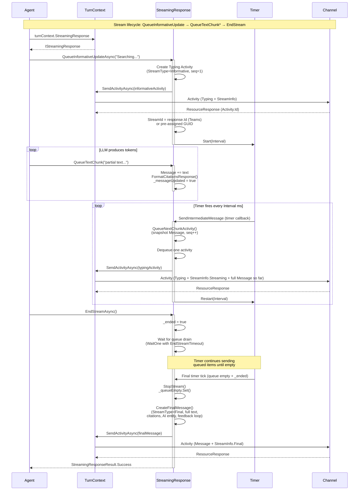
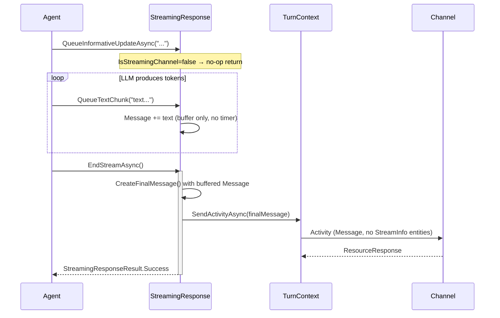
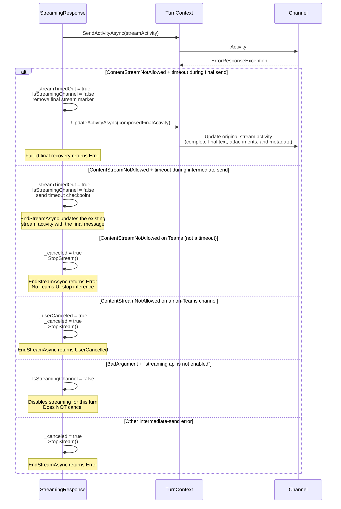
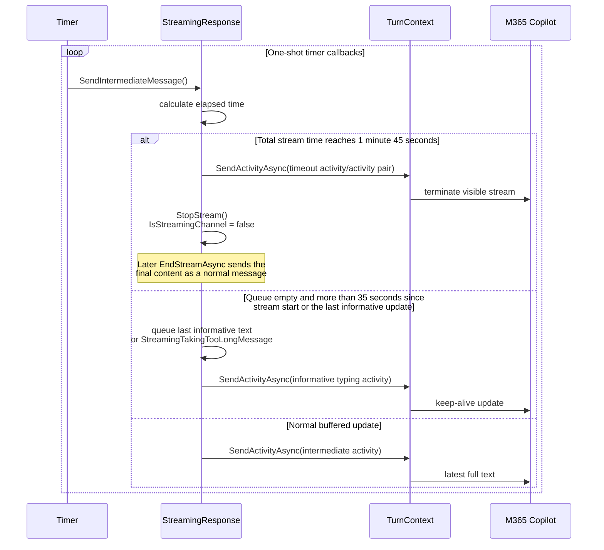

# StreamingResponse Sequence Diagram

Shows how `StreamingResponse` delivers chunked intermediate messages on a timer interval, giving the UX of a streamed message. When complete, a final `ActivityTypes.Message` is sent with the full text and optional attachments, citations, and sensitivity metadata.

## Participants

- **Agent** — The customer's business logic (or an LLM client producing chunks).
- **TurnContext** — Per-turn context; exposes `StreamingResponse` property.
- **StreamingResponse** — SDK-provided chunked message delivery (internal class).
- **Timer** — Internal `System.Threading.Timer` that fires at `Interval` ms.
- **Channel** — The upstream channel (Teams, M365 Copilot, WebChat, DirectLine, or a `DeliveryMode.Stream` transport).

## Channel Defaults

| Channel | Interval | StreamId | Notes |
|---------|----------|----------|-------|
| Teams | 1000ms | Assigned by first response | MUST use Activity.Id from first send |
| WebChat / DirectLine | 500ms | Random GUID | |
| DeliveryModes.Stream SSE | 100ms | Random GUID | |
| M365 Copilot with DeliveryModes.Stream | 100ms | Random GUID | Adds inactivity notices and a channel-specific timeout fallback |
| Other / ExpectReplies | N/A | N/A | Non-streaming; buffers text, sends single final message |

## Streaming Channel Flow

## Non-Streaming Channel Flow

For channels that don't support intermediate messages (`IsStreamingChannel = false`), or `DeliveryMode.ExpectReplies`:

## Teams Service Window and Application Cancellation

Teams enforces a **ten-minute streaming window from the first informative or
content update**. The SDK reacts to the service timeout rather than imposing a
local Teams lifetime timer. `EndStreamTimeout` is a separate, two-minute default
wait for queue draining when ending or resetting a stream; increasing it does not
extend the Teams service window.

Teams no longer exposes the streaming UI Stop feature. A non-timeout
`ContentStreamNotAllowed` response is a service rejection, not proof of user
cancellation. The failed stream reports `Error` when ended. Application
cancellation tokens, the shared `UserCancelled` result, and non-Teams
client-cancellation interpretation remain unchanged.

## Error Handling: Service Rejection, Timeout & Client Cancellation

## M365 Copilot Keep-Alive and Timeout

M365 Copilot uses the normal `DeliveryMode.Stream` setup, plus safeguards for its client timeout behavior.

## Key Implementation Details

- **Timer is one-shot, re-armed after the callback finishes its send** — the callback clears its in-flight guard before re-arming. Timer creation, re-arming, and disposal use the same lock.
- **Callbacks and final sends belong to one stream lifetime** — queued callbacks from a stopped timer are ignored. A late timer-driven or final-send completion from a previous stream cannot update or stop a replacement stream after `ResetAsync`.
- **InitialDelay** (default 250ms) — used for the first `QueueTextChunk` if no informative was sent, enabling faster stream start.
- **Message accumulates** — each intermediate message sends the FULL text so far (not a delta). Channel displays latest as replacement.
- **Final message metadata** — the root `AIEntity` is created or reused for AI labeling, referenced citations, or a sensitivity label. A sensitivity label does not imply AI-generated content. Existing metadata is retained unless the streaming response explicitly supplies its replacement.
- **StreamId** — Teams assigns it from first response; WebChat/DirectLine/DeliveryModes.Stream SSE uses a pre-generated GUID set on every outgoing `Activity.Id`.
- **EndStreamTimeout** — defaults to 2 minutes for queue draining during `EndStreamAsync` / `ResetAsync`, not total stream lifetime. If the queue doesn't drain in time, returns `Timeout`. This does not guarantee that an already pending transport send has completed or been canceled.
- **ResetAsync** — allows reusing `StreamingResponse` for multiple streams in the same turn (waits for current stream to end first).
- **Client timeout fallback** — a Teams timeout error switches to non-streaming mode and updates the existing stream activity with the final message. A timeout during the final send immediately updates the already-composed payload, preserving metadata and attachments without recomposing or duplicating them; failed final recovery returns `Error`. The M365 Copilot proactive timeout path later sends the final content as a normal message even if a timeout notification fails. A reset invalidates the previous stream's pending fallback.
- **M365 keep-alive clock** — the 35-second check is measured from stream start or the last informative update while the queue is empty. Ordinary text chunks and intermediate text sends do not reset this clock.
- **No final payload means no send** — on a non-streaming channel, `EndStreamAsync` sends only when text, a `FinalMessage`, or prior updates exist.

## Related Source Files

| Component | Path |
|-----------|------|
| StreamingResponse | `src/libraries/Builder/Microsoft.Agents.Builder/StreamingResponse.cs` |
| IStreamingResponse | `src/libraries/Builder/Microsoft.Agents.Builder/IStreamingResponse.cs` |
| TurnContext (exposes StreamingResponse) | `src/libraries/Builder/Microsoft.Agents.Builder/TurnContext.cs` |
| StreamInfo entity | `src/libraries/Core/Microsoft.Agents.Core/Models/StreamInfo.cs` |
| StreamTypes constants | `src/libraries/Core/Microsoft.Agents.Core/Models/StreamTypes.cs` |
